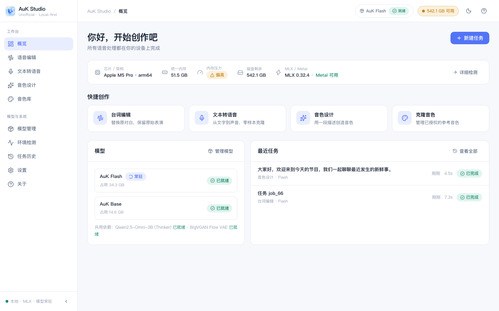
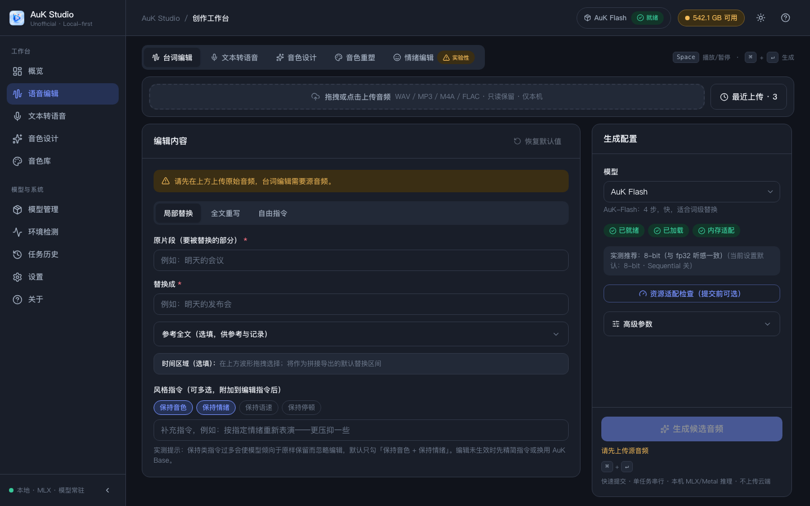
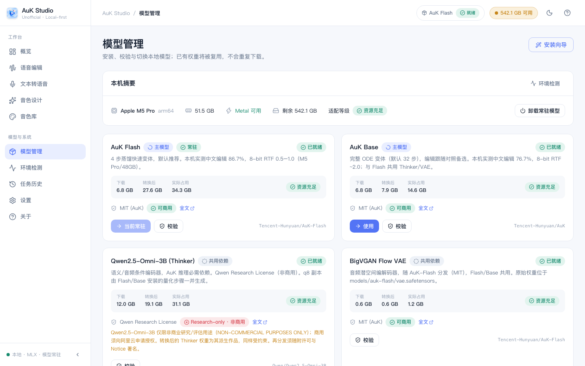
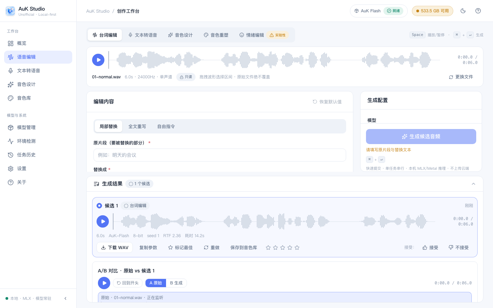

<p align="center">
  
</p>

<h1 align="center">AuK Studio</h1>

<p align="center"><b>面向 Apple Silicon 的本地优先 AI 语音工作台（MLX / Metal）</b></p>

<p align="center">中文 · <a href="README_EN.md">English</a></p>

> **非官方社区项目。** AuK Studio 是独立开发的非官方本地语音工作台，与腾讯或阿里云不存在官方关联或背书。模型与第三方组件按各自许可证授权。当前 AuK 依赖的 Qwen2.5-Omni-3B 使用 Qwen Research License，**仅限非商业研究/评估**，商业使用需另行取得授权。

## 简介

AuK Studio 是运行在 Apple Silicon Mac 上的本地语音编辑与创作工作台：上传一段对白，用自然语言指令替换其中的词或整句，由 **AuK-Flash / AuK Base（MLX + Metal）** 在本机重生成语音——无云端推理、不上传任何音频。A/B 对比候选后，把编辑区间拼回原始录音导出。

> **项目状态（v0.2）**：完整工作台已实现并经过回归测试——概览仪表盘、创作工作台（台词编辑 / 文本转语音 / 音色设计 / 音色重塑 / 实验性情绪编辑）、模型管理与六步安装向导、环境检测、任务历史、音色库、A/B 对比与拼接导出。所有能力以**本机实测门禁**为准，而非上游宣称——见 [docs/CAPABILITIES.md](docs/CAPABILITIES.md)。

## 截图

| 概览（浅色） | 工作台（深色） |
| --- | --- |
|  |  |

| 模型管理 | 结果对比与拼接 |
| --- | --- |
|  |  |

更多：[环境检测](docs/screenshots/system.png) · [音色库](docs/screenshots/voices.png) · [任务历史](docs/screenshots/jobs.png) · [关于与许可](docs/screenshots/about.png) · [1280×800](docs/screenshots/studio-1280.png)

## 功能（能力门禁如实标注）

| 功能 | 状态 | 说明 |
| --- | --- | --- |
| 语音编辑（词/短语/整句替换） | ✅ 可用 | 30 例中文回归：Flash **86.7%**、Base 76.7% |
| 零样本 TTS（同音色整句替换） | ✅ 可用 | 英文 TTS 模板，整句 10/10 |
| 音色设计（指令 TTS，无参考音频） | ✅ 可用 | 描述音色 + 文本，本机实测通过 |
| 音色重塑 | ✅ 可用 | 内容逐字保持；音色变化为主观维度，需试听确认 |
| 情绪编辑 | ⚠️ **实验性** | 实测内容保持，但情绪变化未能客观验证，不承诺效果 |
| 模型管理（安装计划/下载/校验/转换/切换） | ✅ 可用 | manifest 驱动管理界面 + 六步向导；已有权重自动复用，绝不重复下载 |
| 环境检测 | ✅ 可用 | 14 项真实探针，风险项带原因与建议；`scripts/doctor.sh` |
| 任务历史（持久化） | ✅ 可用 | SQLite；重启可查；重试/取消/日志；含安装与校验任务 |
| 音色库 | ✅ 可用 | 本地私有参考音色，强制授权确认记录 |
| A/B 对比与接受标记 | ✅ 可用 | 候选试听、接受标记、评分/最佳、WAV 下载 |
| 拼接导出 | ✅ 可用 | 未修改区域保留**原始 PCM**（逐样本一致），raised-cosine 交叉淡化 |
| 降噪/去混响（音频修复） | ⛔ 不支持 | MLX 分支未实现 |
| 源分离 | ⛔ 不支持 | MLX 分支未实现 |
| 工作台内 ASR / 强制对齐 | ⛔ 不支持 | 逐字稿手动输入（离线 ASR 仅用于开发验证脚本） |

上传支持 WAV / MP3 / M4A / FLAC / OGG / AAC / AIFF / MP4（ffmpeg 回退解码），24kHz mono 标准化，原始文件只读保留。深浅色主题（默认浅色），中文界面。

## 环境要求

- **Apple Silicon Mac**（实测 M5 Pro / macOS 26.5.1），需 Metal
- **推荐 48GB 统一内存**（8-bit 常驻 worker 峰值约 7.6GB；fp32 与 Base 更高）
- **磁盘 ≥ 60GB 可用**（原始权重 ~19GB + MLX 转换 ~28GB）
- 工具链：Homebrew、Git、[uv](https://github.com/astral-sh/uv)、FFmpeg、Node.js ≥ 18

## 快速开始

```bash
# 1. 克隆上游 AuK（MLX 分支）+ 创建 ckpts 符号链接 + Python 3.10 独立环境
#    + AuK[mlx] + 后端依赖 + MLX/Metal 最小测试（脚本自动完成）
./scripts/setup.sh

# 2. 下载模型（约 19GB）。主渠道：ModelScope 官方镜像（国内通常可直连）；
#    按 HF 官方 sha256 校验，断点续传。
./scripts/download_models.sh

# 3. 转换为 MLX 权重 + 8-bit 量化副本（官方推荐精度；已转换产物自动跳过）
./scripts/convert_models.sh
# 可选：AuK Base 对照模型
python3 scripts/download_models.py --only base
./scripts/convert_models.sh --with-base

# 4. 启动
./scripts/start.sh
# 浏览器打开 http://127.0.0.1:7860（端口占用时自动换端口，见启动输出）
```

**网络说明（按需自设）**：模型下载主渠道为 ModelScope（国内通常可直连）；PyPI 默认清华镜像（`AUK_PYPI_MIRROR` 可改）。若你的网络访问 GitHub / HuggingFace 需要代理，请**自行设置** `AUK_SOCKS_PROXY` / `HF_PROXY` 为你的代理地址（例如本地 SOCKS5 代理，格式 `socks5h://主机:端口`）；不设置则直连。安装完成后推理完全离线。

## 日常脚本

| 脚本 | 用途 |
| --- | --- |
| `./scripts/start.sh` | 启动后端 + 内置前端构建（幂等；自动换端口） |
| `./scripts/stop.sh` | 优雅停止（SIGINT → 释放模型；必要时才升级信号） |
| `./scripts/status.sh` | 进程 / 端口 / 模型 / worker / 内存压力状态 |
| `./scripts/doctor.sh` | 环境诊断（芯片、Metal、磁盘、依赖、权重、符号链接） |
| `./scripts/backup.sh` | 备份配置 + 数据库 + 任务元数据（可选 `--with-audio`、`--with-models`） |
| `./scripts/cleanup.sh` | 清理临时文件/缓存——先列出目标并征求确认 |

## 模型选择（M5 Pro / 48GB 实测）

| | AuK-Flash（默认） | AuK Base |
| --- | --- | --- |
| 步数 | 4 步固定 | 32 步（可选 16/48） |
| 速度（6s 音频，8-bit） | ~3–4s（RTF 0.49–0.61） | ~12–14s（RTF 1.97–2.21） |
| 30 例套件平均 | 10.5s（RTF 1.44） | 14.0s（RTF 2.04） |
| 中文编辑准确率（优化模板后） | **86.7%**（词 10/10、整句 10/10、短语 6/10） | 76.7% |
| worker 峰值 RSS（8-bit 常驻） | ~7.6GB | ~7.6GB |
| 适用 | 默认首选，快速迭代 | Flash 失败用例的备选 |

**指令精简原则（实测）**：保持类指令（保持语速/停顿/不夸张…）叠加过多时，模型倾向原样保留而**忽略编辑**——长保持指令下准确率仅 13.3%。默认最多勾选「保持音色 + 保持情绪」；编辑未生效时先精简指令、换种子重试，或改用 Base。

**整句替换用英文 TTS 模板**：`Say the following with the same voice: '{新台词}'` 整句 10/10，而中文内容编辑模板整句 0/10。局部词/短语用「局部片段替换」模式。英文 TTS 模板后**不可**附加中文风格指令——会被模型朗读出来。

## 重要说明（非产品承诺）

- 模型对**整段音频重生成**，修改范围之外的波形不保证与原始一致；保留原声请用拼接导出。
- 音色/情绪/韵律保持是尽力而为，请通过 A/B 主观验收。
- 短语与整句替换不保证一次成功；可换种子多候选。短语替换存在模型能力边界（如时间词锚定）。
- **4-bit 量化导致中文发音可闻退化**（官方结论）——默认 8-bit，界面不提供 4-bit 选项。
- 不含自动 ASR：逐字稿需手动输入。

## 隐私

- 服务仅监听 **127.0.0.1**；本地 API 按设计无鉴权——**切勿暴露到公网**（见 [SECURITY.md](SECURITY.md)）。
- **不上传任何音频、音色模板或遥测**。唯一出网流量是用户主动发起的官方渠道模型/依赖下载。
- 上传以随机 ID 存于 `data/`；原始文件只读；下载限定数据目录。

## 许可证

- **AuK Studio 自研源码：[MIT](LICENSE)**，仅覆盖自研代码。
- **上游 AuK**（代码 + Flash/Base 权重）：MIT，Copyright (c) Tencent。本地安装调用，不复制源码——见 [THIRD_PARTY_NOTICES.md](THIRD_PARTY_NOTICES.md)。
- **Qwen2.5-Omni-3B 编码器（必需）：Qwen Research License——仅限非商业研究/评估。** 商业使用需向阿里云另行申请授权。权重由用户自行下载、不随仓库分发，但这不消除使用限制。因此完整推理链在取得另行授权前**仅限非商业**。详见 [docs/MODEL_LICENSES.md](docs/MODEL_LICENSES.md)。
- 依赖清单：[docs/DEPENDENCIES_LICENSES.md](docs/DEPENDENCIES_LICENSES.md)（实际扫描）。FFmpeg 为用户自装的系统二进制（LGPL/GPL 取决于构建），仅 subprocess 调用，不随仓库分发。
- 只使用你有权使用的参考音频；克隆真实人物声音需取得适当授权，禁止提交未经许可的录音。

## 文档

| 文档 | 内容 |
| --- | --- |
| [docs/CAPABILITIES.md](docs/CAPABILITIES.md) | 能力矩阵（实测门禁） |
| [docs/MODEL_LICENSES.md](docs/MODEL_LICENSES.md) | 模型与组件许可证审查 |
| [docs/DEPENDENCIES_LICENSES.md](docs/DEPENDENCIES_LICENSES.md) | 依赖许可证实测扫描 |
| [docs/UPSTREAM_AUDIT.md](docs/UPSTREAM_AUDIT.md) | 上游代码与命令核验 |
| [docs/BASELINE.md](docs/BASELINE.md) | 升级前基线 |
| [docs/TEST_REPORT.md](docs/TEST_REPORT.md) | 实测结果（30 例套件、模板） |
| [docs/DEPLOYMENT_REPORT.md](docs/DEPLOYMENT_REPORT.md) | 部署记录 |
| [docs/API_CONTRACT.md](docs/API_CONTRACT.md) | API 契约 |
| [docs/RELEASE_CHECKLIST.md](docs/RELEASE_CHECKLIST.md) | 发布门禁核查 |
| [SECURITY.md](SECURITY.md) · [CONTRIBUTING.md](CONTRIBUTING.md) | 安全政策 · 贡献指南 |

## 故障排查

| 症状 | 处理 |
| --- | --- |
| 任务失败「模型文件缺失」 | 运行 `download_models.sh` + `convert_models.sh`；用 `doctor.sh` 检查 |
| Metal 不可用 | `doctor.sh` 诊断；确认 arm64 与 macOS 版本 |
| 内存压力严重 | 关闭大内存应用；模型页卸载模型；改用 sequential |
| 下载中断 | 重跑 `download_models.sh` 自动续传 |
| 端口被占用 | `start.sh` 自动换端口，见启动输出 / `data/runtime.json` |
| 推理慢 | 确认 Metal 可用；Flash 4 步通常数秒；查看 `logs/worker.log` |
| 编辑未生效 | 精简指令（保持 ≤ 音色+情绪）、换种子，或改用 Base |
| 风格指令被朗读 | 英文 TTS 模板后不要附加中文风格指令 |
| `start.sh` 前端构建失败 | `cd app/frontend && npm install && npm run build` 查看真实报错 |
| GitHub / HF 访问失败 | 按需自设 `AUK_SOCKS_PROXY` / `HF_PROXY`；模型主渠道为 ModelScope |

## 贡献

见 [CONTRIBUTING.md](CONTRIBUTING.md)——开发环境、测试要求（pytest + tsc + Playwright UI）、DCO 签名、许可证硬边界（禁止提交权重/音频）。欢迎按模板提 Issue 与 PR。

## 免责声明

AuK Studio 是独立开发的非官方社区项目，与腾讯或阿里云不存在官方关联或背书。「AuK Studio」为暂定工作名，尚待商标检索。Qwen 依赖的推理链仅限研究/评估与个人非商业用途；输出不做保证，用户须自行确保所处理音频的权利合规。见 [LICENSE](LICENSE) 中的保证免责声明。

## 作者与联络

AuK Studio 由 **影脉科技（南京）有限公司** 独立开发与维护。

<p align="center">
  
</p>
<p align="center"><sub>扫码联系我们（微信）</sub></p>

欢迎通过二维码联系我们，或在 GitHub 提 Issue / PR 参与共建。

<!-- QR asset: docs/assets/contact-qr.jpg is the source of truth; keep app/frontend/public/contact-qr.jpg
     in sync (the About page serves it from there). -->