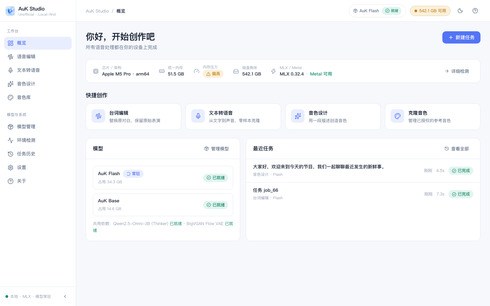
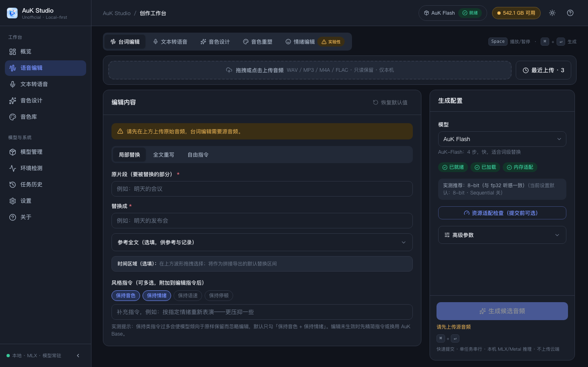
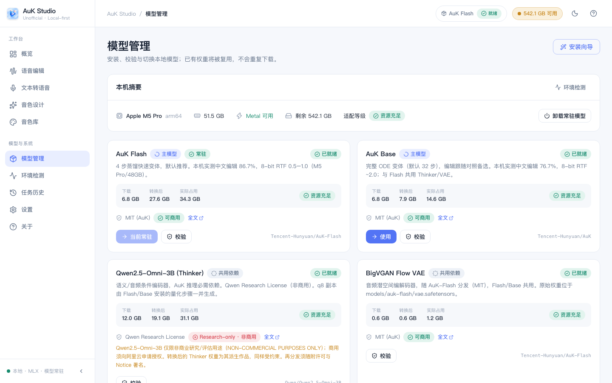
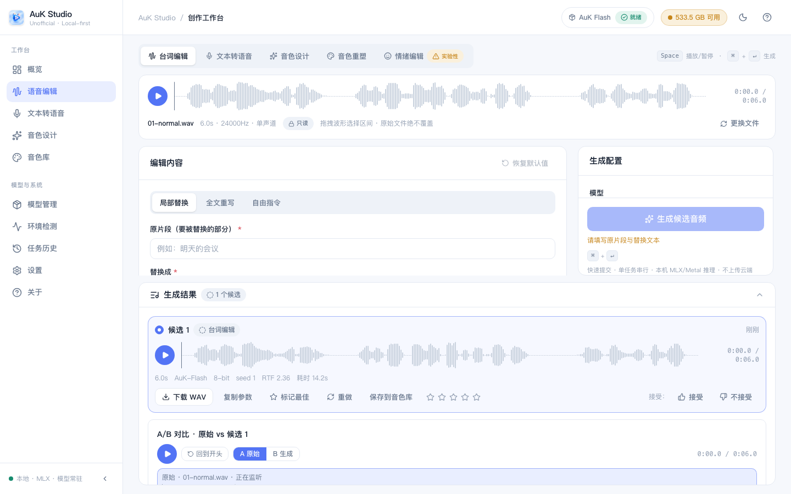

<p align="center">
  
</p>

<h1 align="center">AuK Studio</h1>

<p align="center"><b>Local-first AI Voice Workbench for Apple Silicon (MLX / Metal)</b></p>

<p align="center"><a href="README.md">中文</a> · English</p>

> **Unofficial community project.** AuK Studio is an independent, unofficial open-source interface for local AI audio workflows. It is not affiliated with or endorsed by Tencent or Alibaba Cloud. Model checkpoints and third-party components are governed by their own licenses. The currently required Qwen2.5-Omni-3B encoder is distributed under the Qwen Research License, which limits use to **non-commercial research/evaluation** unless separately licensed.

## What is AuK Studio?

AuK Studio is a local web workbench for AI speech editing and voice creation on Apple Silicon Macs. Upload a line of dialogue, replace words or whole sentences with natural-language instructions, and regenerate the speech on-device with **AuK-Flash / AuK Base running on MLX + Metal** — no cloud inference, no audio uploads. Compare candidates A/B, then splice the edited region back into the original recording.

> **Project status (v0.3):** the full workbench is implemented and regression-tested — dashboard, creation studio (edit / TTS / voice design / timbre / experimental emotion), model manager with guided install wizard, environment diagnostics, job history, voice library, A/B comparison and splice export, plus **optional online TTS providers** (OpenAI-compatible APIs). Local capabilities are gated by real on-device verification, not by upstream claims — see [docs/CAPABILITIES.md](docs/CAPABILITIES.md).

## Screenshots

| Dashboard (light) | Studio (dark) |
| --- | --- |
|  |  |

| Model manager | A/B results & splice |
| --- | --- |
|  |  |

More: [environment diagnostics](docs/screenshots/system.png) · [voice library](docs/screenshots/voices.png) · [job history](docs/screenshots/jobs.png) · [about & licenses](docs/screenshots/about.png) · [1280×800](docs/screenshots/studio-1280.png)

## Features (capability-gated)

| Feature | Status | Notes |
| --- | --- | --- |
| Speech editing (word / phrase / sentence replacement) | ✅ Supported | 30-case Chinese regression: Flash **86.7%**, Base 76.7% |
| Zero-shot TTS (same-voice full-sentence replacement) | ✅ Supported | English TTS template, 10/10 full-sentence accuracy |
| Voice design (instruction TTS, no reference audio) | ✅ Supported | Describe a voice + text; verified on-device |
| Timbre reshape | ✅ Supported | Content preserved; timbre change is subjective — audition required |
| Emotion editing | ⚠️ **Experimental** | Content preserved in tests, but emotion shift not objectively verified; no effect promised |
| Model management (install plan / download / verify / convert / activate) | ✅ Supported | Manifest-driven manager UI + 6-step wizard; existing weights reused, never re-downloaded |
| Environment diagnostics | ✅ Supported | 14 real probes with suggestions; `scripts/doctor.sh` |
| Job history (persistent) | ✅ Supported | SQLite; survives restarts; retry / cancel / logs; install & verify jobs |
| Voice library | ✅ Supported | Local-private reference voices with mandatory consent records |
| A/B comparison & accept | ✅ Supported | Candidate audition, accept marking, rating / favorite, WAV download |
| Splice export | ✅ Supported | Unmodified regions keep the **original PCM** (bit-exact), raised-cosine crossfade |
| Online TTS providers (OpenAI-compatible) | ✅ Supported | Configure on the Models page (OpenAI / SiliconFlow / custom), pick at generation time; **TTS only**, text sent to the third party (explicit choice, local by default) |
| Denoise / dereverb (speech enhancement) | ⛔ Not supported | Not implemented in the MLX branch |
| Source separation | ⛔ Not supported | Not implemented in the MLX branch |
| ASR / forced alignment in the workbench | ⛔ Not supported | Transcripts are entered manually (offline ASR is used only by dev verification scripts) |

Uploads: WAV / MP3 / M4A / FLAC / OGG / AAC / AIFF / MP4 (ffmpeg fallback decoding), normalized to 24 kHz mono; originals kept read-only. Light/dark themes (light by default), Chinese UI.

## Requirements

- **Apple Silicon Mac** (tested: MacBook Pro M5 Pro, macOS 26.5.1); Metal required
- **48 GB unified memory recommended** (8-bit resident worker peak ≈ 7.6 GB; fp32 and Base need more)
- **≥ 60 GB free disk** (raw weights ~19 GB + MLX conversions ~28 GB)
- Toolchain: Homebrew, Git, [uv](https://github.com/astral-sh/uv), FFmpeg, Node.js ≥ 18

## Quick start

```bash
# 1. Clone upstream AuK (MLX branch) + create ckpts symlinks + Python 3.10 venv
#    + AuK[mlx] + backend deps + MLX/Metal smoke test (all automated by the script)
./scripts/setup.sh

# 2. Download models (~19 GB). Primary channel: ModelScope official mirrors (direct in CN);
#    sha256-verified against HuggingFace official hashes, resumable.
./scripts/download_models.sh

# 3. Convert to MLX layout + 8-bit quantized copies (official recommended precision;
#    existing conversions are skipped automatically)
./scripts/convert_models.sh
# Optional: AuK Base comparison model
python3 scripts/download_models.py --only base
./scripts/convert_models.sh --with-base

# 4. Launch
./scripts/start.sh
# Open http://127.0.0.1:7860 (auto-picks another port if busy — see startup output)
```

**Network notes (configure as needed):** model downloads default to ModelScope (usually direct in CN); PyPI defaults to the Tsinghua mirror (`AUK_PYPI_MIRROR` to change). If your network needs a proxy to reach GitHub / HuggingFace, **set your own** `AUK_SOCKS_PROXY` / `HF_PROXY` (e.g. a local SOCKS5 proxy, format `socks5h://host:port`); leave unset for direct connections. All inference is fully offline after setup.

## Daily scripts

| Script | Purpose |
| --- | --- |
| `./scripts/start.sh` | Start backend + built frontend (idempotent; auto port) |
| `./scripts/stop.sh` | Graceful stop (SIGINT → model release; escalates only if needed) |
| `./scripts/status.sh` | Process / port / model / worker / memory-pressure status |
| `./scripts/doctor.sh` | Environment diagnostics (chip, Metal, disk, deps, weights, symlinks) |
| `./scripts/backup.sh` | Backup config + DB + job metadata (`--with-audio`, `--with-models` optional) |
| `./scripts/cleanup.sh` | Clean temp files / caches — lists targets and asks for confirmation first |

## Model selection (measured on M5 Pro / 48 GB)

| | AuK-Flash (default) | AuK Base |
| --- | --- | --- |
| Steps | 4 (fixed) | 32 (16/48 optional) |
| Speed, 6 s clip, 8-bit | ~3–4 s (RTF 0.49–0.61) | ~12–14 s (RTF 1.97–2.21) |
| 30-case suite avg | 10.5 s (RTF 1.44) | 14.0 s (RTF 2.04) |
| Chinese edit accuracy (optimized templates) | **86.7%** (words 10/10, sentences 10/10, phrases 6/10) | 76.7% |
| Peak worker RSS (8-bit resident) | ~7.6 GB | ~7.6 GB |
| Use for | Default; fast iteration | Fallback for cases Flash fails |

**Instruction-minimalism principle (measured):** stacking "keep" instructions (keep pace / pauses / don't exaggerate…) makes the model preserve the original and **ignore the edit** — accuracy collapsed to 13.3% with long style instructions. Keep at most "keep timbre + keep emotion"; if an edit doesn't take effect, simplify instructions, change the seed, or try Base.

**Whole-sentence replacement uses the English TTS template:** `Say the following with the same voice: '{text}'` scored 10/10, while the Chinese content-edit template scored 0/10 on full sentences. Use partial-replacement mode for words/phrases. Do **not** append Chinese style instructions after the English TTS template — the model will read them aloud.

## Important notes (not product promises)

- The model **regenerates the entire segment**; waveform outside the edit is not guaranteed identical. Use splice export to keep original audio in unmodified regions.
- Timbre / emotion / prosody preservation is best-effort — verify subjectively via A/B.
- Phrase and sentence edits may need several seeds / candidates; phrase replacement has known model limits (e.g., time-word anchoring).
- **4-bit quantization audibly degrades Chinese pronunciation** (official finding) — default is 8-bit; the UI offers no 4-bit option.
- No built-in ASR: transcripts are typed manually.

## Inference providers (local / online)

- **Local MLX is the default**: with no online provider configured, everything runs on-device and no data leaves your machine.
- **Online TTS (optional)**: add an OpenAI-compatible service under Models → "Inference Providers" (presets: OpenAI / SiliconFlow / custom) with base_url / API key / model / voice and a one-click connectivity test. The setup wizard can configure it too — once set, you may skip local model installation and use TTS directly.
- Pick the provider in the generation config panel. **Online supports TTS only** (editing / timbre reshape remain local-exclusive); selecting an online provider shows a prominent notice naming the target service.
- API keys are stored only in the local database and masked everywhere in UI/logs. Online tasks are always an explicit user choice, never the default.

## Privacy

- Server binds to **127.0.0.1 only**; the local API is unauthenticated by design — **never expose it to the public internet** (see [SECURITY.md](SECURITY.md)).
- **In local mode, no audio, voice templates, or telemetry leave your machine.** Outbound traffic is limited to user-initiated model/package downloads from official sources.
- **When an online provider is selected, the spoken text is sent to that third-party service** (the UI prominently shows the target domain); generated audio files are still stored locally.
- Uploads stored under random IDs in `data/`; originals read-only; downloads confined to the data directory.

## License

- **AuK Studio source code: [MIT](LICENSE).** This covers only our original code.
- **Upstream AuK** (code + Flash/Base weights): MIT, Copyright (c) Tencent. Installed locally, not vendored — see [THIRD_PARTY_NOTICES.md](THIRD_PARTY_NOTICES.md).
- **Qwen2.5-Omni-3B encoder (required): Qwen Research License — non-commercial research/evaluation only.** Commercial use requires a separate license from Alibaba Cloud. Weights are downloaded by you, never shipped with this repo; that does not remove the use restriction. The complete inference chain is therefore **non-commercial** until separately licensed. Details: [docs/MODEL_LICENSES.md](docs/MODEL_LICENSES.md).
- Dependencies: see [docs/DEPENDENCIES_LICENSES.md](docs/DEPENDENCIES_LICENSES.md) (actual scan). FFmpeg is a user-installed system binary (LGPL/GPL depending on build), invoked via subprocess, never bundled.
- Only use reference audio you have rights to. Voice cloning of real people requires appropriate authorization; do not submit unauthorized recordings.

## Documentation

| Doc | Content |
| --- | --- |
| [docs/CAPABILITIES.md](docs/CAPABILITIES.md) | Capability matrix (measured gating) |
| [docs/MODEL_LICENSES.md](docs/MODEL_LICENSES.md) | Model & component license review |
| [docs/DEPENDENCIES_LICENSES.md](docs/DEPENDENCIES_LICENSES.md) | Actual dependency license scan |
| [docs/UPSTREAM_AUDIT.md](docs/UPSTREAM_AUDIT.md) | Upstream code/CLI verification |
| [docs/BASELINE.md](docs/BASELINE.md) | Pre-upgrade baseline |
| [docs/TEST_REPORT.md](docs/TEST_REPORT.md) | Test results (30-case suite, templates) |
| [docs/DEPLOYMENT_REPORT.md](docs/DEPLOYMENT_REPORT.md) | Deployment record |
| [docs/API_CONTRACT.md](docs/API_CONTRACT.md) | API contract |
| [docs/RELEASE_CHECKLIST.md](docs/RELEASE_CHECKLIST.md) | Pre-release compliance gates |
| [SECURITY.md](SECURITY.md) · [CONTRIBUTING.md](CONTRIBUTING.md) | Security policy · contribution guide |

## Troubleshooting

| Symptom | Fix |
| --- | --- |
| Job fails with "model files missing" | Run `download_models.sh` + `convert_models.sh`; check `doctor.sh` |
| Metal unavailable | `doctor.sh`; confirm arm64 + supported macOS |
| Severe memory pressure | Close memory-hungry apps; unload models on the Models page; enable sequential mode |
| Download interrupted | Re-run `download_models.sh` — resumes automatically |
| Port already in use | `start.sh` auto-picks a free port; see startup output / `data/runtime.json` |
| Slow inference | Confirm Metal is available; Flash 4-step is usually seconds; check `logs/worker.log` |
| Edit not applied | Simplify instructions (keep ≤ timbre+emotion), change seed, or try Base |
| Style instruction read aloud | Don't append Chinese style text after the English TTS template |
| Frontend build fails in `start.sh` | `cd app/frontend && npm install && npm run build` to see the real error |
| GitHub / HF unreachable | Set your own `AUK_SOCKS_PROXY` / `HF_PROXY` if needed; ModelScope is the primary model channel |

## Contributing

See [CONTRIBUTING.md](CONTRIBUTING.md) — dev setup, testing (pytest + tsc + Playwright UI), DCO sign-off, and hard license boundaries (no weights/audio commits). Issues and PRs welcome; use the templates.

## Disclaimer

AuK Studio is an independent, unofficial community project, not affiliated with or endorsed by Tencent or Alibaba Cloud. "AuK Studio" is a working name pending trademark clearance. This software is provided for research/evaluation and personal non-commercial use of the Qwen-dependent inference chain; outputs are not guaranteed, and you are responsible for the rights to any audio you process. See the [LICENSE](LICENSE) warranty disclaimer.

## Author & Contact

AuK Studio is independently developed and maintained by **影脉科技（南京）有限公司** (Nanjing, China).

<p align="center">
  
</p>
<p align="center"><sub>扫码联系我们 — Scan to contact us (WeChat).</sub></p>